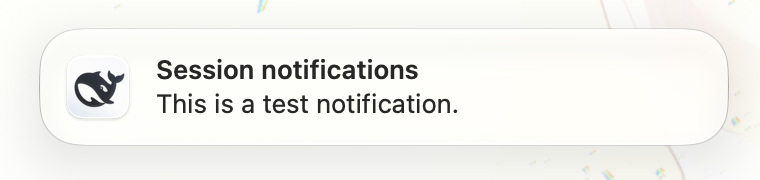
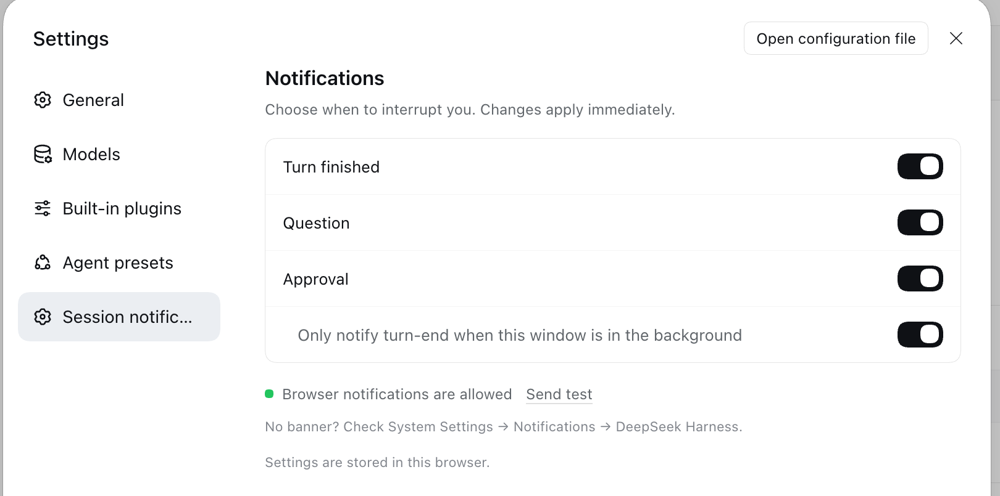

# dsh-session-bell

English | [简体中文](README.zh.md)

Desktop notifications for DeepSeek Harness.

A turn that finishes, a question that waits for your answer, or an approval that
waits for your decision raises one native notification. In the Desktop app the
sender is DeepSeek Harness itself, not a helper app; in a browser page (`dsh web`)
the browser sends it. A click opens the Session that raised it.



## What it does

| Event | Notification |
| --- | --- |
| A turn completes (`session/event` → `turn/end`) | Session title, then the first sentence of the last reply |
| A turn fails or hits the output limit | Session title, then the failure or the limit |
| A question waits for a human (`user-questions/request`) | Session title, then the question |
| An approval waits for a human (`approval/request`) | Session title, then the tool and its reason |

- Every root Session can report. Subagent Sessions stay quiet for all events;
  their parent turn still reports.
- A completion waits 1.5 seconds and stays quiet while a subagent or a background
  job still works for the same Session, or while the next round of an active goal
  is already queued. An active goal with no queued round still notifies.
  A failed turn and an output-limit turn notify immediately. An aborted,
  interrupted, or blocked turn is silent.
- An approval body carries the tool name and, when DSH provides one, the reason.
  A localized `displayReason` is preferred and the raw `reason` is the fallback.
- Notifications are keyed by Session: a newer event for a Session closes that
  Session's previous banner, whatever its kind.
- Click: focus the window, then select that Session in the Conversation panel.
- The body is plain text: Markdown marks are removed, then the text is clipped
  to 80 characters. A turn-end body keeps its first sentence, though a stop
  after a known abbreviation such as `Dr.` reads on to the next one; a question
  is not cut at a sentence, and an empty body falls back to the localized label.
- The title is plain text too: whitespace is collapsed, then the title is clipped
  to 30 characters. A blank title falls back to the app name.

## Settings

Open More → Settings, then choose Notifications in the settings sidebar.



| Switch | What it does |
| --- | --- |
| Turn finished | Notify when a turn completes, fails, or hits the output limit. |
| Question | Notify when a question waits for an answer. |
| Approval | Notify when an approval waits for a decision. |
| Only notify while this window is in the background | When on, a focused window shows no notifications. When off, every event notifies. Default on. |

Switches apply immediately; there is no save button. Settings are stored locally
in the app (localStorage), not in the app configuration. Turning on one of the
three notification switches asks for the page permission when the browser has
not decided yet; Send test does the same. The section shows the page
notification permission and a Send test action; if no banner appears, see
Requirements for the system permission.

Approval notifications appear only when the session asks for approval. A session
whose approval policy never asks sends no approval notification.

## Requirements

- DeepSeek Harness with the Web GUI (Desktop app or `dsh web`).
- The window must be open. The page raises the notification, so a closed window sends nothing.
- The operating system must allow notifications for DeepSeek Harness (Desktop
  app) or for your browser (`dsh web`). On macOS, open System Settings →
  Notifications. On Windows, open Settings → System → Notifications.

## Install

In DeepSeek Harness, open the Plugins page from the sidebar, choose Install
bundle, and enter:

```
dsh-session-bell
```

After the first install, reload the page once (⇧⌘R). The Host half is live at
install time, but the page half is a browser module and loads only with a fresh page.
After an update, reload the page and toggle the plugin once. The Host half and the
page half must come from the same version.

## How it works

Two halves, one route.

1. Host half (`index.js`) listens to `session/event`, `user-questions/request`,
   and `approval/request`. For a completed turn it waits 1.5 seconds, asks
   `workspace/session-activity` whether a subagent or a background job still runs
   for that Session, and asks the goal service whether the next round of an
   active goal is already queued; either answer keeps the banner quiet. An
   active goal with no queued round does not silence a completion. It turns
   each event into a Server-Sent Event on `/session-bell/events`. No Web server
   means no route and no work, so the CLI stays silent.
2. Page half (`client.js`) subscribes to that route, filters events by the
   switches, suppresses notifications while the window is focused, and raises
   the native notification. A newer event for the same Session closes that
   Session's previous banner. A click opens that Session, an empty body is
   localized in the page, and a closed stream reconnects by itself.

The route carries Session id, a clipped title, a clipped body, the event kind,
a turn-end status (`completed`, `error`, or `max-tokens`), and for approval the
tool name and reason. Settings stay in localStorage. Nothing leaves
the machine; there is no network egress.

The route inherits the web server's binding and has no authentication of its
own. Keep `dsh web` on loopback: a network bind exposes this route along with
every other one.

## Local development

```bash
npm install
npm test
```

Link the directory as a bundle and toggle the plugin once:

```
plugin_manager install_bundle  <absolute path to this directory>
plugin_manager set_plugin      include:session-bell  enabled:false
plugin_manager set_plugin      include:session-bell  enabled:true
```

After a change, reload the page for `client.js` and the plugin for `index.js`.

## Releasing

[`.github/workflows/publish.yml`](.github/workflows/publish.yml) publishes on every push to
`main`, but only when `package.json` names a version that npm does not have yet. It uses npm
trusted publishing (OIDC), so the repository stores no token, and it attaches provenance.
It calls the test workflow first; the publish job runs only after the Node 20, 22, and 24
matrix passes.

1. Bump the version and add the CHANGELOG entry.
2. Push to `main`.

```bash
npm version patch          # or minor, major
git push --follow-tags
```

One setup step lives on npmjs.com: Settings → Trusted publishing must name this repository
and the workflow file `publish.yml`. Without it the job fails with `ENEEDAUTH`.

## Layout

| Path | Role |
| --- | --- |
| `index.js` | Host half: events to Server-Sent Events |
| `client.js` | Page half: settings page, notification, click to open the Session |
| `cordis.patch.yml` | Bundle patch that inserts the Host row |
| `locale/*.json` | Plugin Manager title and description |
| `icon.svg` | Plugin Manager icon |
| `test/` | Node tests for Host events and client filtering |

## License

MIT
