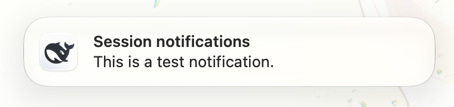
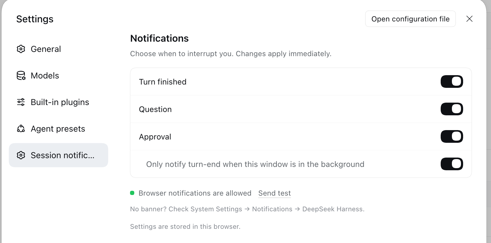

# dsh-session-bell

[English](README.md) | 简体中文

DeepSeek Harness 的桌面通知插件。

回合结束、有提问等你回答，或有审批等你决定时，弹一条系统通知。发送方是
DeepSeek Harness 本体，不是外部助手应用。点通知直接跳到发起该通知的会话。



## 行为

| 事件 | 通知内容 |
| --- | --- |
| 回合结束（`agent/turn-stopping`） | 会话标题 + 最后一条回复正文 |
| 有提问等回答（`user-questions/request`） | 会话标题 + 问题正文 |
| 有审批等决定（`approval/request`） | 会话标题 + 工具名 |

- 所有根会话都可通知；子代理会话对三类事件都不通知，其父回合照常通知。
- 按会话去重：同一会话的新事件会关掉该会话的上一条横幅，不论类型。
- 点击：聚焦窗口，并在会话面板选中该会话。

## 设置

打开左下角 More → Settings（设置），在设置侧栏选「会话通知」。



| 开关 | 作用 |
| --- | --- |
| 回合结束 | 回合停止时通知。 |
| 提问 | 有提问等待回答时通知。 |
| 审批 | 有审批等待决定时通知。 |
| 仅在窗口处于后台时通知 | 开启时，窗口有焦点就不发任何通知；关闭时每个事件都发。默认开启。 |

开关立即生效，没有保存按钮。设置存在本机应用内（localStorage），不写入应用配置。
该分区显示浏览器通知权限和“发送测试”。这是页面权限，不是系统权限。
若一直不弹，允许 DeepSeek Harness 发通知。提示按页面所在系统选路径：macOS 指
「系统设置 → 通知」，Windows 指「设置 → 系统 → 通知」，其他系统只说去系统通知设置。

审批通知只在会话请求审批时出现；审批策略从不询问的会话不会发审批通知。

## 要求

- DeepSeek Harness 且启用 Web GUI（桌面版或 `dsh web`）。
- 窗口必须开着：通知由页面发出，窗口关闭时不发。
- 系统需允许 DeepSeek Harness 发通知。macOS 在「系统设置 → 通知」，Windows 在
  「设置 → 系统 → 通知」，其他系统在各自的系统通知设置里。

## 安装

在 DeepSeek Harness 打开侧栏的“插件”页，选“安装 Bundle”，填入：

```
dsh-session-bell
```

首次装好后刷新一次页面（⇧⌘R）。宿主半装完即生效，页面半是浏览器模块，只在新页面加载。
升级后要刷新页面并重启一次插件；宿主半和页面半必须来自同一版本。

## 原理

一个路由，两半。

1. 宿主半（`index.js`）监听 `agent/turn-stopping`、`user-questions/request` 和
   `approval/request`，把事件写成 `/session-bell/events` 上的 Server-Sent Events。
   审批只带工具名，不带命令或理由。没有 Web 服务时不注册路由，CLI 下静默。
2. 页面半（`client.js`）订阅该路由，按开关过滤事件，窗口有焦点时不发任何通知，
   再用页面自带 `Notification` 构造通知。同一会话的新通知会先关掉上一条。点击时调用
   `ctx.uiWorkspace.openSession(sessionId)`。空正文由页面本地化。浏览器永久关掉
   这条流（`readyState` 为 CLOSED）时，页面 3 秒后重开，宿主启动得晚也不会让
   窗口一直静默。

路由带会话 id、标题、截断后的正文、事件类型；审批另带工具名。设置在 localStorage，
没有网络外发。

## 本地开发

```bash
npm install
npm test
```

把目录当 bundle 装进 profile，然后改宿主半要重启插件、改页面半要刷新页面：

```
plugin_manager install_bundle  <本目录绝对路径>
plugin_manager set_plugin      include:session-bell  enabled:false
plugin_manager set_plugin      include:session-bell  enabled:true
```

## 发布

[`.github/workflows/publish.yml`](.github/workflows/publish.yml) 在每次推 `main` 时运行，
只有当 `package.json` 的版本在 npm 上还不存在时才发布。用 npm trusted publishing（OIDC），
仓库里不存 token，并附带 provenance。

1. 改版本号，补 CHANGELOG 条目。
2. 推 `main`。

```bash
npm version patch          # 或 minor、major
git push --follow-tags
```

npmjs.com 上要做一次设置：包 → Settings → Trusted publishing，填本仓库与工作流文件名
`publish.yml`。没配的话任务会以 `ENEEDAUTH` 失败。

## 目录

| 路径 | 作用 |
| --- | --- |
| `index.js` | 宿主半：事件转 SSE |
| `client.js` | 页面半：设置页、发通知、点击开会话 |
| `cordis.patch.yml` | bundle 补丁，插入宿主行 |
| `locale/*.json` | 插件管理器的标题与描述 |
| `icon.svg` | 插件管理器图标 |
| `test/` | 宿主事件与页面过滤的 Node 测试 |

## 许可

MIT
